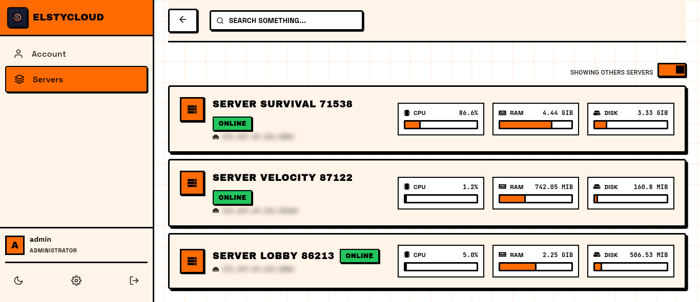
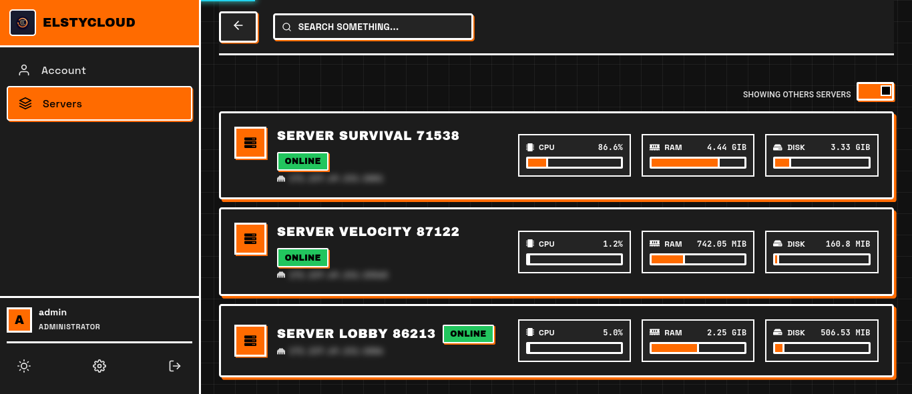
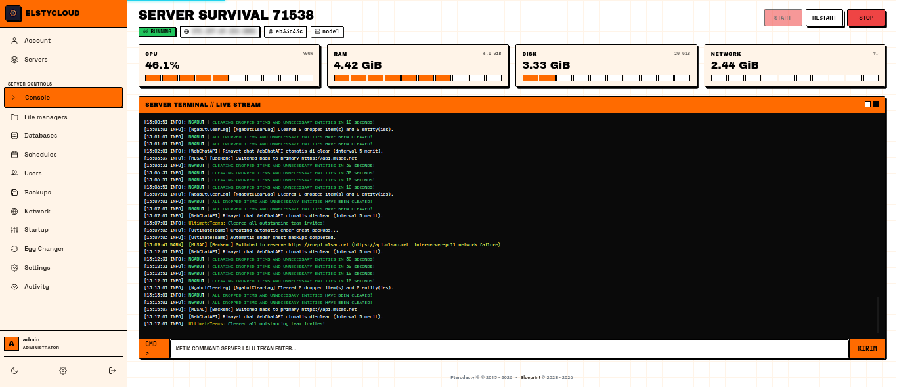
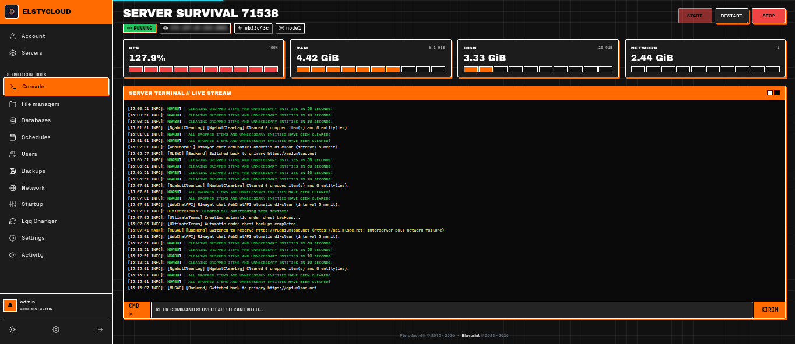
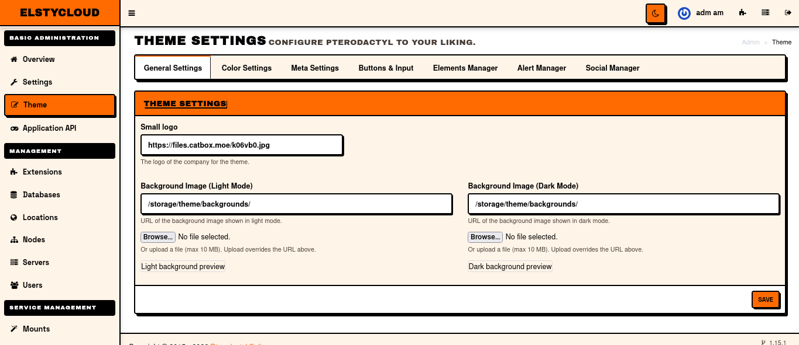

# NEOBRUTALIS-Pterodactyl

Tema Neo-Brutalism untuk Pterodactyl Panel.


## Showcase

| Dashboard (Light) | Dashboard (Dark) |
| --- | --- |
|  |  |

| Console (Light) | Console (Dark) |
| --- | --- |
|  |  |



## Fitur

- Gaya neo-brutalism: border tebal, shadow keras, tipografi tebal, tanpa gradasi.
- Dashboard server dengan kartu status, CPU/RAM/Disk bar.
- Halaman console, network, files, dan admin panel yang di-restyle.
- Dark mode toggle.
- New Page EGG Changer
- IP dan port diblur secara default — klik untuk membuka.

## Instalasi

Prasyarat build asset: [dokumentasi Pterodactyl](https://pterodactyl.io/community/customization/panel.html).

```bash
cd /var/www/pterodactyl
# salin file tema ke direktori panel, lalu:
yarn install
yarn build:production
php artisan optimize:clear
```

Jika build gagal dengan `error:0308010C:digital envelope routines::unsupported` (Node 18+):

```bash
NODE_OPTIONS=--openssl-legacy-provider yarn build:production
```

## Development

```bash
yarn watch      # build development
yarn lint       # eslint resources/scripts
```

## Struktur

| Path | Isi |
| --- | --- |
| `resources/scripts/components/` | Komponen React yang di-restyle |
| `resources/views/` | Blade template panel dan admin |
| `public/assets/` | Asset hasil build |
| `.blueprint/` | Konfigurasi Blueprint framework |

## Lisensi

MIT
